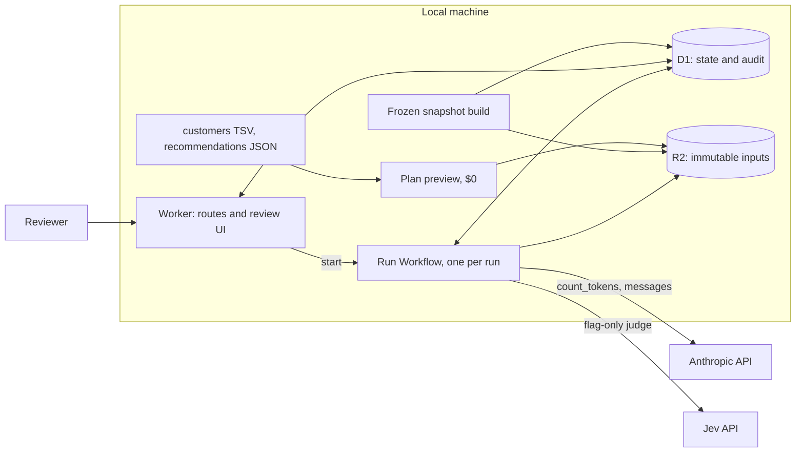

# High-level design

Status: `draft`, compared with the built code on 2026-11-01. Interfaces and rules are in [contracts.md](contracts.md). Decisions: [ADR 0001](adr/0001-platform.md), [ADR 0002](adr/0002-frozen-snapshot.md), [decisions.md](decisions.md).

## Context

A reviewer wants each customer to get a personalised result and wants to approve it before anything goes out. The hard part is the batch, not the page: one bad customer must not stop the run, spend must be bounded before a call, a crash must not repeat paid work, and a release must be impossible without approval.

| requirement | met by |
|---|---|
| Each customer gets one result from one run | One `units` row per customer, ending `drafted`, `failed{code}` or `skipped{code}`. One live draft per customer, by unique index |
| Products, copy and images come from nicobar.com | A frozen snapshot. Code renders every title, image and link by id. The model never outputs one |
| One bad customer stops nothing | Per-customer steps, coded failures, a run that closes around them |
| Approval before release | A state machine in D1, with `CHECK` constraints and a hash bound at approval |
| Deep dive | Eval leads. A short cost note follows |
| Voice; nothing made up | Code checks before review, an advisory judge, then a person |

## Components

| component | job |
|---|---|
| Worker (`src/worker/`) | Review, approve, release, config, catalog and run routes, and the Start a run page. Identity from Access, or a local dev actor. Starting a run also takes the run key. Both fail closed |
| Run Workflow (`src/workflow/`) | `pin → prep → estimate → admit → generate → finish → close`, one set of steps per customer |
| D1 | The record: runs, units, plans, drafts, every cost, Jev and approval event, and prompt, Jev, ranking and catalog versions |
| R2 | Immutable by hash or snapshot id: catalogue, customer file, recommendation file, previews |
| Library (`src/lib/`) | Pure code: ingest, plan, request building, checks, rendering, cost, state edges |
| Ranking engine (`src/lib/rank/`, `npm run rank`) | No model. Writes the recommendations file from the snapshot and `config/ranking.json`, offline, or inside the Worker at Start a run at the active version. Filter, weighted score, fixed guards. Occasion must outweigh the other four signals together, with room for the `push_down` penalty, and the hero must fit the occasion |
| Catalog viewer (`/review/catalog`) | Every snapshot row with its rules. An override is saved as a version, and the ranking reads the active one. It never edits the snapshot |
| `config/` | Schemas, check lists, cost tables. Bundled. Prompts are imported into D1 as versions |

Not used: Queues, Durable Objects, Agents SDK, Vectorize, KV, the Batches API, and the store's cart, checkout or order tools.

## Data flow

1. **Build.** `scripts/build.ts` reads the frozen pull, strips and filters it to 2,165 usable products, snapshot of 2026-11-01, and publishes `catalog.json` and `rules.json`.
2. **Preview.** `scripts/preview.ts`, or the Start a run page, plans every customer and counts tokens with no paid generation. It stores the preview by hash. A run must quote that hash.
3. **Pin.** `POST /api/runs`, behind the run key, pins snapshot, inputs, prompt, Jev, ranking and catalog versions on the run row. A file ranked at any other version than the active one is refused. Activating a new prompt mid-run changes nothing in that run.
4. **Prep.** Each customer gets a stored plan, or a coded failure at $0. The product list is rendered and checked here, before any spend.
5. **Admit.** One pass before any generation commits twice the estimate per customer. Over the cap means skipped and logged.
6. **Generate.** One warm call, then `GEN_CONCURRENCY` at a time. One call returns email and landing page together.
7. **Finish.** Render, check, retry the failed part once, carry the passing part byte for byte, run the flag-only judge, insert one draft row.
8. **Review.** A person approves or rejects one draft row, which holds all parts. Approval binds the content hash.
9. **Release.** Checks run again on the stored model output, then freshness, then `released`.

## Trust boundaries

| input | treated as | control |
|---|---|---|
| Customer TSV, recommendation file | Untrusted | Validated per row. A pick not in the snapshot fails that customer. Occasion text is escaped on render |
| Past purchase note | Kept away from the model | The sentence stops at ingest. A check fails model prose that echoes a past item. Code may head a rail "To go with your shirt", using one word from the note |
| Last name | Kept away from the model and the deployed link | Stops at ingest |
| Model output | Untrusted | Schema, then checks. Slot tokens stand in for products. The model emits no id, title, URL, image, price or markup |
| Rendered HTML | Code's own | Image gate, link gate and alt checks run on the render, with no script in the review frame |
| Reviewer identity | From a verified Access token only | Never from a request body. Auth fails closed on missing config |
| Run key | A secret that starts spending | Compared as digests, five wrong tries lock it for 15 minutes, never stored, echoed or logged. No key on the server means no run. `npm run demo` makes a random one per launch and keeps it in memory |

**What the model sees:** the shared prompt, the occasion text, shape, occasion key, pick facts and allowed quotes. **What it never sees:** a name, a last name, a purchase note, a tag or a price.

## Failure isolation

A failed customer is a row, not an exception. `prep` returns data for bad rows, and any throw in a customer's steps becomes `failed{INTERNAL_ERROR}` for that customer. Jev never fails a customer: a timeout or an empty reserve is logged and the draft carries on.

Every step reads its own output first, so a replay does nothing. A generate step marks `calling` before the call. If a restart finds an unsettled call, it records `possibly_billed` and moves to attempt 2, never repeating attempt 1. Billed attempts are limited to 2 by a `CHECK`.

## Cost envelope

Planning figures, except the measured line. See the [write-up](WRITEUP.md#cost-note).

| | figure |
|---|---|
| per 20-customer run, measured once | $0.6834 Anthropic, $0.0018 Jev: run `voice-mvxmeplv`, Sonnet 5.5, prompt v2 |
| per 20-customer run, planned | $0.79 expected, $3.71 worst by `max_tokens` (default rung; start rung is a run setting) |
| per 1,000 | $39–46 on Sonnet sync; $0.7 on Haiku, untested for voice |
| fixed | $0 local; $5/month for a hosted review link |
